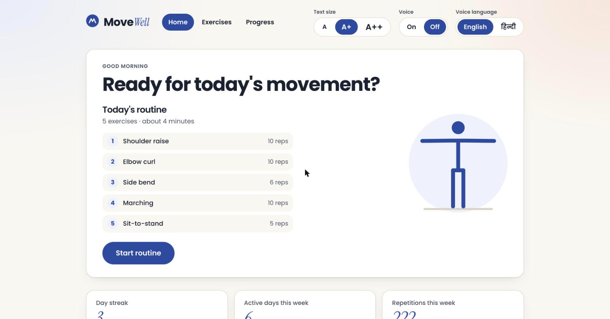
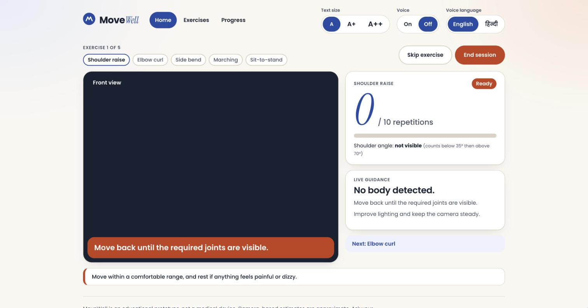
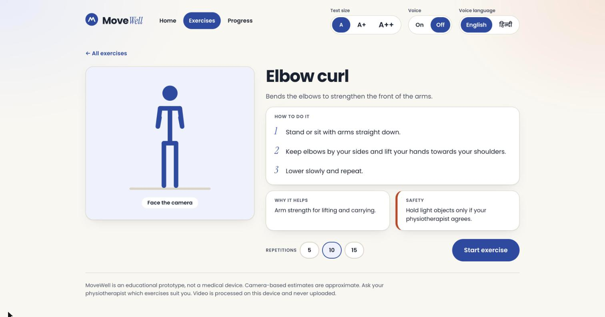
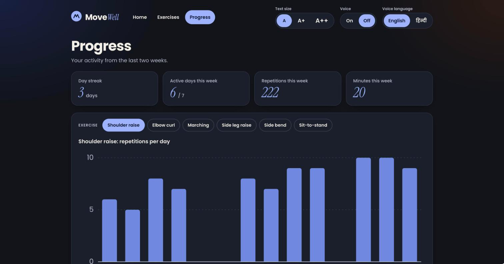
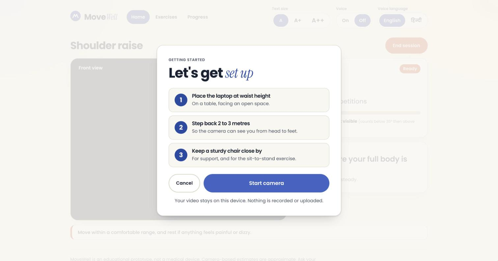

# MoveWell

Gentle, camera-guided exercise for older adults. MoveWell runs a short daily routine through any laptop webcam, counts repetitions, speaks encouragement in English or Hindi, and tracks progress over time. Pose estimation runs entirely on the device; video is never recorded or uploaded.

**Live app:** <https://soumyadepp.github.io/movewell/>



> Educational prototype, not a medical device. 2-D webcam pose estimates are approximate and depend on camera placement, lighting and clothing. Exercise selection and range of motion should be agreed with a qualified clinician.

## Screenshots

| Guided workout | Exercise library |
|---|---|
|  |  |
| **Progress (dark mode)** | **Camera setup** |
|  |  |

## Features

- **Guided daily routine.** Five exercises with targets, automatic rest breaks with a countdown, spoken transitions, and a summary at the end.
- **Six exercises plus posture check.** Shoulder raise, elbow curl, marching, side leg raise, side bend and sit-to-stand. Each has an animated demo, step-by-step instructions, its benefit and a safety tip, and the camera view switches automatically to the best angle.
- **Reliable counting.** Hysteresis thresholds on joint angles, debounced posture feedback and tolerance for brief tracking dropouts keep counts and on-screen guidance steady.
- **Progress tracking.** Day streak, weekly active days, repetitions and minutes, and a per-exercise daily chart with an accessible table view. History stays in the browser and can be exported as CSV.
- **Voice in English and Hindi.** Pre-recorded clips that work offline. Counts and announcements queue so nothing is cut off; user actions interrupt.
- **Built for older eyes.** Adjustable text size, high-contrast palette (WCAG AA for all text, AAA for body text), large labeled controls, visible focus, screen-reader support, and respect for system contrast and reduced-motion settings.

## Repository

| Path | Contents |
|---|---|
| [`web/`](web/README.md) | The MoveWell web app (Svelte 5, TypeScript, Vite). Start here. |
| `src/physio_assistant/` | Python desktop app (OpenCV window), one module per exercise |
| `tests/` | Python test suite |
| `docs/screenshots/` | Images used in this README |
| `.github/workflows/` | GitHub Pages deployment |

## Getting started

### Web app

```bash
cd web
npm install
npm run dev
```

Open <http://localhost:5173>, choose **Start routine** and allow camera access. Stand 2 to 3 metres from the camera so your whole body is visible. See [`web/README.md`](web/README.md) for scripts, architecture, design tokens and how to add exercises or languages.

### Python desktop prototype

Requires Python 3.12 and [uv](https://docs.astral.sh/uv/).

```bash
uv sync --extra voice
uv run physio-assistant
```

Options: `--camera <index>`, `--no-voice`, `--no-mirror`, `--data-file <path.csv>`. Keys `1` to `7` select posture check and the six exercises, `V` switches view, `Space` toggles the timer, `S` saves and `Q` quits. A standalone build is available with `uv run --extra voice --group build pyinstaller --noconfirm physio_assistant.spec`.

The desktop app shares the web app's counting logic: 3-D joint angles, dwell and dropout tolerance, and the same false-positive guards. It does not include the guided routine, exercise library or progress dashboard.

Each exercise is its own module in `src/physio_assistant/exercises/` implementing the `Exercise` protocol (`base.py`): its measurement, thresholds, best camera view and copy. `registry.py` lists them in order, and `analysis/counting.py` counts any of them. To add one, create a module, register it, and add a test module under `tests/exercises/`.

## Architecture

Both apps share the same layered design. Pose landmarks are mapped to a fixed 960 × 720 reference frame, analysed by pure functions, and turned into state changes and semantic events; rendering, audio and storage sit behind small interfaces.

| Pattern | Purpose |
|---|---|
| Registry + Strategy | Each exercise or camera view contributes one measurement function or rule set |
| Template Method | One hysteresis state machine counts every exercise |
| State machine | The guided routine moves through exercise, rest and done phases |
| Observer | Analysis publishes semantic events; voice and UI react in their own language |
| Ports and Adapters | MediaPipe, storage and audio are replaceable |
| Facade | The UI talks to a single controller and never touches the camera or model |

## Testing

```bash
cd web && npm test && npm run check   # web: unit tests and type check
uv run pytest && uv run ruff check .  # Python
```

All tests use synthetic poses and a fake clock, so no camera is needed.

## Deployment

Every push to `main` runs the web tests, type check and build, then publishes `web/dist` to GitHub Pages. The site is static and can also be served from any other host.

## Privacy

Pose estimation runs locally (MediaPipe Tasks in the browser, or MediaPipe in Python). No video, images or landmarks leave the device. Session history and preferences are stored in the browser's local storage. The web app downloads the MediaPipe runtime and model from public CDNs on first load.
