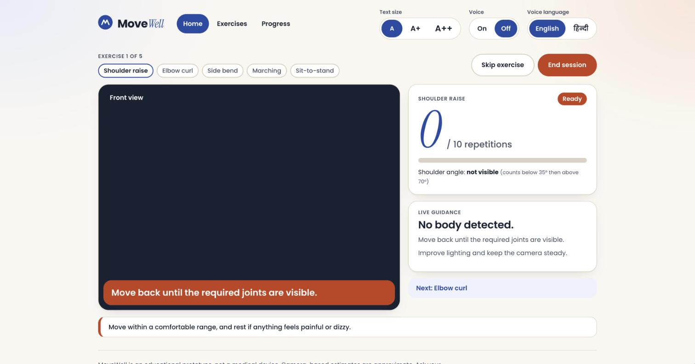

# MoveWell web app

The browser version of MoveWell, built with Svelte 5, TypeScript and Vite. Pose estimation runs on the device with MediaPipe Tasks (WebAssembly); no backend is required.



## Quick start

```bash
npm install
npm run dev        # http://localhost:5173
```

Requires Node.js 20+. The camera only works on `localhost` or over `https://`.

## Scripts

| Command | Description |
|---|---|
| `npm run dev` | Development server with hot module reload |
| `npm run build` | Type-safe production build to `dist/` |
| `npm run preview` | Serve the production build |
| `npm test` | Unit tests (Vitest, Node environment) |
| `npm run check` | `svelte-check` and `tsc` |
| `npm run voice:generate` | Re-record voice clips with macOS system voices |

## Project structure

```
src/
├── main.ts                     entry point
├── App.svelte                  app shell and routing outlet
├── styles/
│   ├── tokens.css              design tokens (primitive, semantic, component)
│   └── base.css                reset, typography, shared component classes
└── lib/
    ├── domain/                 models, geometry, exercise metadata (pure)
    ├── analysis/               posture rules, exercise measures, progress stats
    ├── assistant.ts            session state, rep counting, history
    ├── routine.ts              guided routine state machine
    ├── stable.ts               debouncing and smoothing of noisy pose data
    ├── events.ts               typed event bus
    ├── i18n/speech.ts          spoken phrase catalogs (en, hi)
    ├── infrastructure/         MediaPipe adapter, audio, local storage
    ├── controller.svelte.ts    reactive facade: routing, camera, routine, preferences
    ├── messages.ts             all on-screen copy
    ├── illustrations.ts        stick-figure poses for exercise demos
    ├── components/             reusable UI (header, counter, chart, stage...)
    └── screens/                Home, Exercises, Exercise detail, Workout, Summary, Progress
public/voice/                   pre-recorded clips + manifest.json
scripts/generate-voice.ts       clip generator
```

Everything under `domain/`, `analysis/`, `assistant.ts`, `routine.ts` and `stable.ts` is framework-free and unit tested. Components only talk to `controller.svelte.ts`.

## Routes

Hash-based, so the app works on any static host and the browser back button behaves as expected.

| Route | Screen |
|---|---|
| `#/` | Home: today's routine, streak and weekly stats |
| `#/exercises` | Exercise library |
| `#/exercises/:slug` | Exercise detail with animated demo |
| `#/workout/routine` | Guided routine |
| `#/workout/:slug?target=10` | Single exercise |
| `#/workout/posture` | Posture check |
| `#/summary` | Session summary |
| `#/progress` | Progress dashboard and history export |

## Design tokens

Styles are driven by three tiers of CSS custom properties in `src/styles/tokens.css`:

1. **Primitives**: palette ramps (`--indigo-700`, `--terracotta-700`, `--sand-50`...), type scale, 4px spacing scale, radii, shadows and motion.
2. **Semantic**: roles such as `--color-text`, `--color-surface`, `--color-primary`, `--color-warning`. This is the only tier redefined for dark mode (`prefers-color-scheme` or `data-theme="dark"`) and high contrast (`prefers-contrast: more`).
3. **Component**: per-component decisions such as `--button-height`, `--card-padding`, `--chart-bar`.

Components use semantic and component tokens only, never primitives or raw values. Text size is controlled by `--text-scale`, set through `data-text-size` on the root element.

Contrast: every text pair meets WCAG AA, body text meets AAA. Chart fills are validated for lightness and contrast against both surfaces.

## Voice

Spoken feedback plays pre-recorded clips from `public/voice/<lang>/<key>.m4a`, listed in `manifest.json`. The app speaks phrase keys (`count_7`, `mode_elbow_curl`, `goal_reached`...), never raw text, so every language is a catalog in `src/lib/i18n/speech.ts`.

Priorities keep speech calm: user actions interrupt, counts and announcements queue, and hints are dropped if anything else is speaking. If a clip is missing the Web Speech API is used as a fallback.

To change a phrase or voice, edit the catalog and run `npm run voice:generate` on macOS. Only changed phrases are re-recorded.

## Adding an exercise

1. Add the mode to `ExerciseMode`, `COUNTED_EXERCISES` and `BEST_VIEW` in `lib/domain/models.ts`.
2. Add a measure function to `MEASURES` in `lib/analysis/exercises.ts`.
3. Add thresholds (`config.ts`), copy (`EXERCISE_COPY` in `messages.ts`), spoken phrases (`i18n/speech.ts`) and a demo pose (`illustrations.ts`).
4. Run `npm test` and `npm run voice:generate`.

The test suite fails if an exercise is missing thresholds, copy or translations.

## Testing

```bash
npm test
npm run check
```

Tests use synthetic poses and a fake clock, so they need no camera or browser.

## Deployment

`npm run build` produces a static site in `dist/` with relative asset paths, so it can be served from any sub-path. The repository's GitHub Actions workflow tests, type-checks, builds and publishes it to GitHub Pages on every push to `main`.
